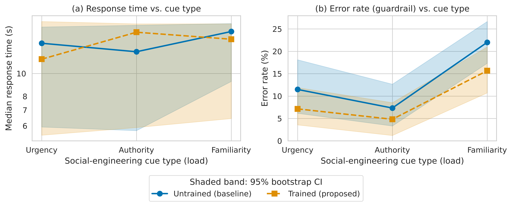
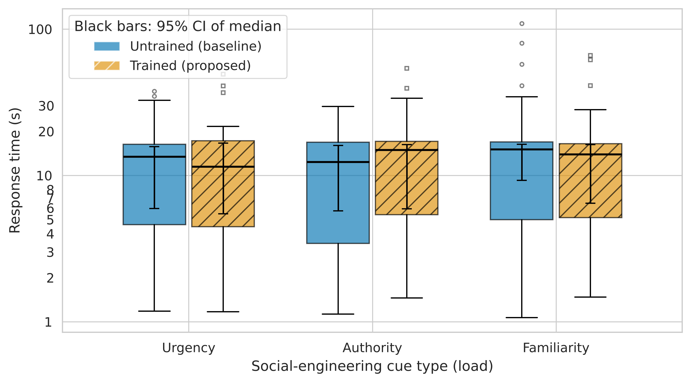

# Predictors of Phishing and Social-Engineering Susceptibility Among University Students

**The Role of Field of Study, Prior Training, and Self-Confidence**

**Authors:** Alexander Grankin · Kenzhebaiuly Yerzhan
**Course:** SCOM3001-ENG-10 — Research Methods (Task 2: Methodology Card & Research Repository)
**Status:** measurement pipeline tested on a synthetic sample; full data collection planned for Week 7.

---

## Overview

Phishing studies of university students mostly report *self-reported* knowledge or attitudes, while
objective-performance models are built for corporate employees. This project measures students' **actual
detection accuracy** on 18 simulated phishing / legitimate messages and tests which individual factors predict it.

### Research questions

| | Question | Primary test |
|---|---|---|
| **RQ1** | Does phishing detection accuracy differ between IT/security majors and non-IT majors? | Welch t-test (one-sided) |
| **RQ2** | Is prior cybersecurity training associated with higher detection accuracy, after controlling for major, year and digital literacy? | Welch t-test + OLS with covariates |
| **RQ3** | Is there a gap between students' confidence and their actual accuracy, and does it differ by cue type (urgency, authority, familiarity)? | Paired t-test + Friedman test |

Full hypotheses, variable matrix, metrics and baselines: [`docs/methodology_card.md`](docs/methodology_card.md).
Survey items and answer key: [`docs/survey_instrument.md`](docs/survey_instrument.md), [`configs/config.yaml`](configs/config.yaml).

## Repository structure

```
phishing-susceptibility-students/
├── .github/workflows/ci.yml     # builds the Docker image and runs tests + pipeline on every push
├── configs/
│   └── config.yaml              # ALL experiment parameters: IV groups, answer key, filters, guardrails
├── data/
│   ├── raw/                     # full survey export (git-ignored, never committed)
│   └── sample/
│       └── survey_sample.csv    # 8 synthetic respondents for pipeline testing
├── docs/
│   ├── methodology_card.md      # Methodology Passport Card
│   └── survey_instrument.md     # questionnaire + 18 vignettes
├── notebooks/                   # exploratory analysis (Week 8+)
├── results/                     # run outputs, one folder per run (git-ignored)
├── scripts/
│   └── run.sh                   # one-command local run without Docker
├── src/
│   ├── benchmark.py             # entry point: load → filter → score → test → guardrails → write
│   ├── scoring.py               # accuracy, hit / false-alarm rate, d′, confidence gap, KR-20
│   ├── analysis.py              # RQ1–RQ3 statistical tests, Holm correction
│   └── guardrails.py            # respondent filters + study-level guardrail metrics
├── tests/
│   └── test_pipeline.py         # unit + end-to-end tests (stdlib unittest)
├── Dockerfile
├── requirements.txt             # exact pins of the full dependency tree
├── LICENSE                      # MIT
└── README.md
```

## Planned benchmarks (analyses)

| ID | Comparison | Primary metric | Baseline | Statistic | Decision rule |
|---|---|---|---|---|---|
| B0 | All students vs guessing | Detection accuracy | 50 % chance level | one-sample t | p < .05 |
| B1 (RQ1) | IT vs Non-IT majors | Detection accuracy | Non-IT majors | Welch t (one-sided), Hedges g | Holm-adj. p < .05 |
| B2 (RQ2) | Trained vs untrained | Detection accuracy; b_training | Untrained students | Welch t + OLS (major, year, digital literacy) | Holm-adj. p < .05 |
| B3 (RQ3a) | Confidence vs accuracy | Over-confidence gap (pp) | Perfect calibration (gap = 0) | paired t, Wilcoxon | Holm-adj. p < .05 |
| B4 (RQ3b) | Urgency vs authority vs familiarity | Gap per cue (pp) | Equal gaps | Friedman χ² | p < .05 |
| B5 | Self-rating vs accuracy | Spearman ρ | ρ = 0 | Spearman | p < .05 |

**Guardrails** (checked on every run, reported in `metrics.json`): exclusion rate ≤ 20 %, ≥ 30 respondents per group,
KR-20 ≥ 0.60, item difficulty 0.20–0.95, false-alarm increase vs baseline ≤ 10 pp, runtime ≤ 60 s.

## System requirements

* **Option A:** Docker ≥ 20.10 (any OS) — nothing else needed.
* **Option B:** Python 3.13 and `pip` (Linux, macOS or Windows).
* ~200 MB disk space for the image / virtual environment; no GPU, no internet access during the run.

## Quickstart

**Docker (recommended)**

```bash
git clone https://github.com/Sszechss/phishing-susceptibility-students.git && cd phishing-susceptibility-students
docker build -t phishing-study .
docker run --rm -v "$(pwd)/results:/app/results" phishing-study
```

> Windows PowerShell: replace `$(pwd)` with `${PWD}`.

**Python (without Docker)**

```bash
python -m venv .venv && source .venv/bin/activate        # Windows: .venv\Scripts\activate
pip install --no-deps -r requirements.txt
python src/benchmark.py --config configs/config.yaml
```

or simply `bash scripts/run.sh` (creates the venv, runs the tests and the pipeline).

**Expected output** — a new folder `results/<timestamp>_sample/` containing:

| File | Content |
|---|---|
| `run.log` | step-by-step log: exclusions, accuracy, RQ1–RQ3 p-values, guardrail PASS/FAIL |
| `metrics.json` | all test statistics, effect sizes, Holm-adjusted p-values, guardrails, environment versions, config hash |
| `respondent_scores.csv` | per-respondent accuracy, hit / false-alarm rate, d′, confidence and gap by cue |
| `exclusions.csv` | excluded respondents and the reason |

On the 8-row sample 2 respondents are excluded (attention check, too fast) and several guardrails report
`FAIL` (group size, reliability). This is expected: the sample only verifies that the pipeline runs end to end;
the guardrails are meant for the full dataset (`mode: full`, `fail_on_violation: true`).

**Tests:** `python -m unittest discover -s tests -v`

## Running on the full dataset (Week 7)

1. Export the form responses to `data/raw/survey_responses.csv` using the column names in `docs/survey_instrument.md`.
2. In `configs/config.yaml` set `mode: full`, `input_csv: data/raw/survey_responses.csv`, `fail_on_violation: true`.
3. Run the same Quickstart command. Raw data stays local — `data/raw/` is git-ignored.

## Ethics

Participation is anonymous and voluntary with an informed-consent item; no names, e-mail addresses or student IDs
are collected. Vignettes are mock-ups of fictitious organisations shown inside the questionnaire — **no real
phishing messages are sent to anyone.** The sample file contains synthetic data only.

## Citation

```bibtex
@misc{grankin_kenzhebaiuly_2026_phishing,
  author = {Grankin, Alexander and Kenzhebaiuly, Yerzhan},
  title  = {Predictors of Phishing and Social-Engineering Susceptibility Among University Students},
  year   = {2026},
  howpublished = {\url{https://github.com/Sszechss/phishing-susceptibility-students}},
  note   = {SCOM3001-ENG-10 research project}
}
```

## License

Code and documentation are released under the [MIT License](LICENSE).

---

## Task 3: Research results, data analysis and visualization

Task 3 adds the real survey data (40 classmates, 800 rows), an executed analysis notebook and publication-ready figures. The 18 messages in the survey follow the instrument from Task 2 (`docs/survey_instrument.md`, answer key in `configs/config.yaml`), plus 2 practice messages. The survey runs as a Google Apps Script web app that saves every answer to a Google Sheet (`survey/`).

> **Data status.** `data/raw/test_run.jsonl` holds the real answers of 40 classmates (convenience sample, 800 rows). The sample is modest, so the results are preliminary.

### Mapping of benchmark terms

| Benchmark term | In this study |
|---|---|
| Latency (ms) | Response time of a student to one message (s) |
| Load | Social-engineering cue type (urgency, authority, familiarity) |
| Error rate (guardrail) | Share of wrong answers |
| Warm-up | The 2 practice messages (`phase = warmup`), discarded |
| Baseline vs Proposed | Students without vs with prior cybersecurity training |

### Task 3 files

```
data/raw/test_run.jsonl              raw answers (warm-up and evaluation, one answer per line)
data/processed/metrics_summary.csv   aggregated metrics by group, cue type and channel
docs/domain_model.md                 STRIDE threat model + metric collection points
notebooks/01_data_analysis.ipynb     executed, reproducible analysis (seed 42)
reports/figures/                     fig1 / fig2 as .pdf and .png (300 dpi)
reports/baseline_vs_proposed.md      results table
src/process_data.py                  loading, warm-up and quality filters, bootstrap statistics
src/visualize.py                     figure generation
survey/                              Apps Script backend and publishing instructions
```

Reproduce: `pip install pandas numpy matplotlib seaborn`, then `python src/process_data.py` or run the notebook (Kernel -> Restart & Run All).

### Results & Discussion

Evaluation answers only. Filters fixed in advance: practice messages removed; respondents failing the attention check removed (1 of 40, a trained student); answers faster than 1 s treated as accidental clicks and removed (4 rows). This leaves 698 answers from 39 students. Response time is reported as median (p25-p75) and mean +- SD; 95% confidence intervals are cluster-bootstrap intervals over students (2000 resamples, seed 42).

| Group | Students | Answers | Response time, median (p25-p75), s | Response time, mean +- SD, s | p95 / p99, s | Median 95% CI, s | Error rate (guardrail), % | Error 95% CI, % |
|---|---|---|---|---|---|---|---|---|
| Untrained (baseline) | 25 | 448 | 14.1 (4.3-16.8) | 11.9 +- 9.5 | 20.7 / 36.3 | [6.1; 15.9] | 13.6 | [10.3; 17.0] |
| Trained (proposed) | 14 | 250 | 14.0 (5.0-16.9) | 12.5 +- 9.7 | 23.7 / 51.7 | [5.9; 16.2] | 9.2 | [7.2; 11.2] |



*Figure 1. (a) Median response time (log scale) and (b) error rate by cue type; shaded bands are 95% bootstrap CIs. Lines connect categories only to show the group difference.*



*Figure 2. Response-time distribution per cue type; black bars show the 95% CI of the median.*

**Discussion.** The error rate is the guardrail metric: a group that answers faster but makes more mistakes is not better. Trained students made fewer errors (9.2% vs 13.6%). Their intervals ([7.2; 11.2] vs [10.3; 17.0]) overlap slightly, so this is a possible benefit of training but not a conclusive one, especially with only 14 trained against 25 untrained students. Response times are almost identical (median 14.0 s vs 14.1 s, heavily overlapping intervals), so training did not make students noticeably slower or faster. Familiarity cues were the hardest for both groups (error 22.0% untrained, 15.7% trained) and authority cues the easiest (7.3% and 4.8%). By channel, e-mail had the most errors and SMS the fewest. Both groups were slightly overconfident: mean confidence exceeded accuracy by about 4 percentage points. Limitations: a convenience sample of classmates, self-reported training status, unequal group sizes, 18 fictional messages instead of real inbox behaviour, and wide per-cell intervals (degenerate when a cell has no errors, e.g. SMS for trained students). Vector versions of the figures (`.pdf`) are in `reports/figures/`.

Threat model and metric collection points: [docs/domain_model.md](docs/domain_model.md).
