# Domain model: STRIDE threat model of the phishing questionnaire

## 1. System and metric collection points

The research system is a small web questionnaire (Google Apps Script web app) that appends each respondent's answers to a Google Sheet, plus a data pipeline.

```mermaid
flowchart LR
    S[Student<br/>respondent] -->|opens link| Q[C1 Questionnaire page<br/>survey/phishing_survey.html]
    Q -->|answer + timer| M[(M1 Metric collection<br/>response_time_ms, correct,<br/>confidence_pct)]
    M -->|google.script.run, JSONL| CH[C2 Apps Script endpoint<br/>appends rows to Google Sheet]
    CH --> R[Researcher]
    R -->|copy column A| D[(C3 data/raw/test_run.jsonl)]
    D --> P[C4 src/process_data.py<br/>warm-up and quality filters, bootstrap CI]
    P --> O[(C5 data/processed/<br/>metrics_summary.csv)]
    O --> V[C6 src/visualize.py<br/>figures PDF + PNG]
    V --> G[C7 GitHub repository]
    D --> G
```

| ID | Component | What it does | Metric collection point |
|---|---|---|---|
| C1 | Questionnaire page (HTML + JavaScript) | Shows 2 practice + 18 fictional messages (e-mail, SMS, messenger), records the answer, time and confidence | **M1**: `performance.now()` timer starts when the message is shown and stops at the answer click |
| C2 | Collection channel (Google Apps Script web app writing to a Google Sheet) | Receives the JSONL answers | none |
| C3 | Raw log `test_run.jsonl` | One line = one answer | warm-up / evaluation split by `phase` |
| C4 | `process_data.py` | Filters warm-up, failed attention checks and answers faster than 1 s, computes median, p95, p99, bootstrap 95% CI, error rate | **M2**: guardrail metric `error_rate` |
| C5 | `metrics_summary.csv` | Aggregated metrics | none |
| C6 | `visualize.py` | Builds fig1 and fig2 | none |
| C7 | GitHub repository | Public storage of code, aggregates, figures | none |

**Protected assets:** respondent anonymity (A1), integrity of the answers and timings (A2), availability of the questionnaire (A3), validity of the published results (A4).

## 2. STRIDE threat matrix

| STRIDE category | Threat | Component | Asset | Mitigation |
|---|---|---|---|---|
| **S**poofing | A person (or a bot) submits answers pretending to be a student of the target university | C1, C2 | A2, A4 | Link shared only in student chats; a respondent id is random, the major is self-reported and checked for plausibility; duplicate answer sets are removed |
| **S**poofing | A fake copy of the questionnaire is spread that collects personal data | C1 | A1 | Students get the link only from the researchers; the page has no input fields for personal data (name, e-mail, phone) |
| **S**poofing | The public collection URL is found and flooded with fake rows | C2 | A2, A4 | The endpoint accepts only valid JSON; flooded or duplicate respondents are removed before analysis; the URL is shared only in student chats |
| **T**ampering | A student edits the JSONL (times, correctness) before it is sent | C1, C2 | A2, A4 | `correct` and timings are computed by the page itself; the pipeline drops respondents who fail the attention check and answers faster than 1 s; other suspicious rows are inspected manually |
| **T**ampering | Raw data is modified after collection | C3, C7 | A2 | Git history shows every change; raw file is changed only by appending |
| **R**epudiation | A researcher cannot show where an analysed row came from | C3, C4 | A4 | Every figure is built by `01_data_analysis.ipynb` from the committed raw file with a fixed seed (42); the raw file keeps every row, filters are applied in code and counted in the notebook |
| **I**nformation disclosure | Answers reveal identity (name, e-mail) | C1, C3, C7 | A1 | No name, e-mail or IP is asked or stored; only a random id, major, age, year, training yes/no and self-ratings; small groups are not reported separately |
| **I**nformation disclosure | Real-looking phishing links in the messages lead to real sites | C1 | A1 | All addresses use the reserved `.example` domain and are not clickable |
| **D**enial of service | Page does not open on the student's device | C1 | A3 | Single page opened from a link in any browser, no installation needed |
| **D**enial of service | Large junk dump breaks the repository | C7 | A3 | `.gitignore` blocks large raw dumps; only a small sample and aggregated CSV are committed |
| **E**levation of privilege | A malicious script in a pasted answer runs on the researcher's computer | C3, C4 | A2 | Data is parsed only as JSON (never executed); the page escapes all text before showing it |

## 3. Residual risks

* Self-selection of volunteers and the self-reported `prior_training` / `major` fields cannot be verified technically.
* Response time depends on the student's device and attention, so only differences between conditions are interpreted, not absolute times.
